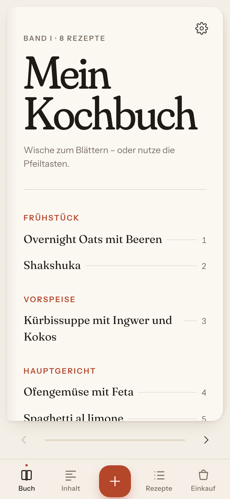
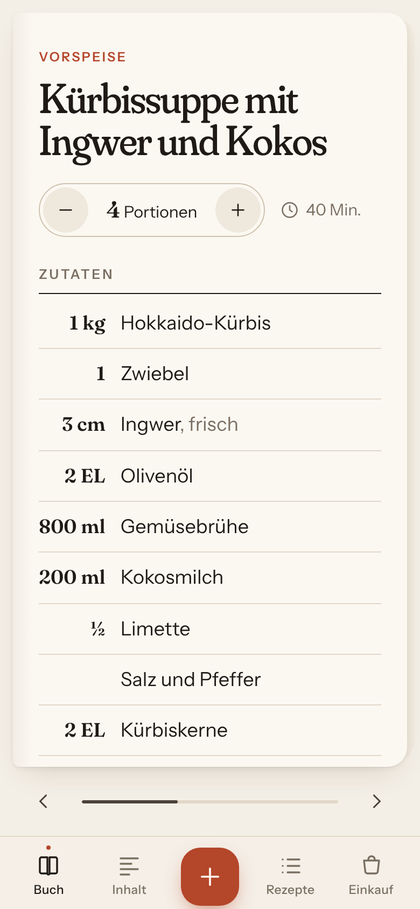
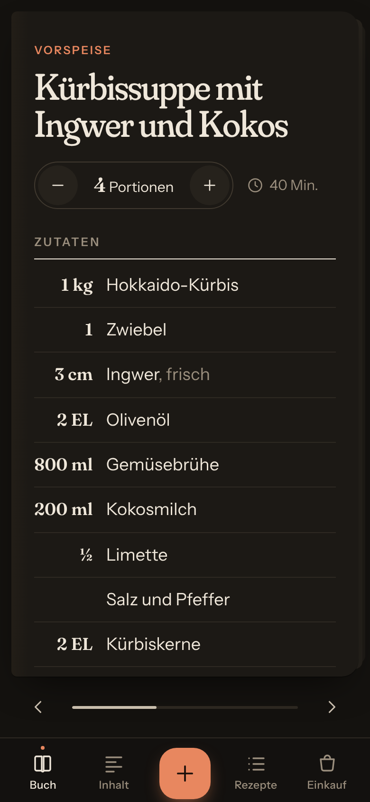
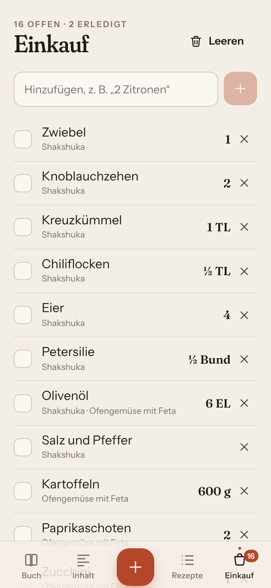

# Kochbuch

Eine Progressive Web App für dein Handy: Screenshots von Rezepten hochladen, **Claude** (Anthropic) liest sie aus, und daraus wird ein durchblätterbares Kochbuch. Kein eigener Server, kein Tracking. Die Rezepte liegen im Browser-Speicher des Handys (IndexedDB), auf Wunsch zusätzlich in eurem privaten GitHub-Repository (Synchronisation zwischen mehreren Handys).

<p>
  
  
  
  
</p>

## Funktionen

- **Import**: mehrere Screenshots oder Fotos auf einmal per Dateiauswahl, Kamera, Drag & Drop, Einfügen (Strg+V) oder **Teilen → Kochbuch** (Android). Optional zuschneiden. Mehrere Bilder können **ein** Rezept ergeben. **Rezept per Link**: Webadresse einfügen (oder auf Android aus dem Browser „Teilen → Kochbuch“) – Claude ruft die Seite ab und liest das Rezept, die Quelle wird am Rezept verlinkt. Alternativ Rezepttext einfügen oder ein Rezept von Hand anlegen.
- **Rezepterkennung mit Claude** (eigener API-Schlüssel, Einrichtung siehe unten): Claude Opus 5.5 liest Titel, Portionen, Zeit, Zutaten (Menge, Einheit, Name, Notiz, Zwischenüberschriften), Schritte und Tipps und schlägt eine Kategorie vor. Steht kein Rezeptname im Bild, bleibt der Titel leer zum selbst Eintragen. Das Originalbild bleibt am Rezept gespeichert.
- **Prüfbildschirm**: alle Felder editierbar, Original daneben (Handy: ausklappbar oben). Zutaten auch „als Text“ bearbeitbar.
- **Buchansicht**: eine Rezeptseite pro Ansicht, Titelseite mit Inhaltsverzeichnis, Blättern per Wischen, Pfeiltasten oder Buttons, mit Seiten-Animation. Beim Kochen Zutaten und Schritte antippen, um sie abzuhaken.
- **Liste + Detail**: Suche über Titel, Zutaten und Schritte (umlauttolerant: „kurbis“ findet „Kürbis“), Filter nach Kategorie. Am Handy Liste → Detail, am großen Bildschirm nebeneinander.
- **Kochmodus** („Jetzt kochen“): ein Schritt pro Bildschirm, große Schrift, der Bildschirm bleibt an, die passenden Zutaten mit Mengen stehen direkt beim Schritt. Wischen oder Weiter/Zurück.
- **Sprachsteuerung im Kochmodus** (Mikrofon-Knopf): „weiter“, „zurück“, „vorlesen“, „Zutaten“, „Timer 10 Minuten“, „Timer starten“ (Zeit aus dem Schritt), „Stopp“. Jeder neue Schritt wird vorgelesen. Nutzt die Spracherkennung des Handys (iPhone: über Apple, Internet nötig).
- **Timer aus dem Text**: Zeitangaben wie „20 Minuten köcheln“ werden zu Timer-Knöpfen. Mehrere Timer gleichzeitig, sichtbar auf jeder Seite, mit Ton und Vibration. (Bei gesperrtem iPhone pausiert die App – im Kochmodus bleibt der Bildschirm deshalb an.)
- **Tags** wie „Thea“, „Familie“, „Fleisch“: frei vergeben, Rezeptliste danach filtern, die Suche findet sie, „Was koche ich heute?“ berücksichtigt sie.
  - **Claude schlägt beim Einlesen 3–5 Tags vor** (vorausgewählt, antippen zum Entfernen). Es nimmt zuerst eure vorhandenen Tags, neue nur aus einer festen Liste (vegetarisch, vegan, Fleisch, Fisch, schnell, Backen, Meal Prep, Gäste, glutenfrei, laktosefrei).
  - **Eigene Tags erklären** unter „Mehr → Tags“, z. B. „Thea = mild, ohne Alkohol“. Nur erklärte eigene Tags vergibt Claude, unerklärte nie. Die Erklärungen werden mit synchronisiert.
  - **Bestehende Rezepte verschlagworten:** „Mehr → Tags → Tags für bestehende Rezepte vorschlagen“ zeigt eine Vorschlagsliste zum Abhaken; vorhandene Tags bleiben erhalten.
- **Mit Claude**: „Was koche ich heute?“ (alle passenden Rezepte aus dem eigenen Buch plus 3 neue Ideen nach euren Wünschen, die Claude auf Knopfdruck als vollständiges Rezept ausarbeitet; Fehlendes mit einem Tipp auf die Einkaufsliste), **Zutat ersetzen** (Ersatz mit Menge, direkt ins Rezept übernehmen) und **Rezept anpassen** (vegetarisch, vegan, glutenfrei, kindgerecht, schneller … – als eigene Variante, das Original bleibt).
- **Inhaltsverzeichnis** nach Kategorien. Kategorien anlegen, umbenennen, sortieren, löschen. Mehrere Kategorien pro Rezept möglich.
- **Portionen umrechnen** mit +/–. Brüche bei EL, TL und Stück („1½“, „¾“), Dezimalzahlen mit Komma und sinnvoller Rundung bei g und ml („190 g“ statt „187,5 g“), Plural („1 Zehe“ → „2 Zehen“).
- **Einkaufsliste**: aus einem oder mehreren Rezepten (Rezeptliste → „Auswählen“). Gleiche Zutaten werden zusammengefasst und Einheiten umgerechnet (500 g + 1 kg = 1,5 kg). **Per Sprache befüllen** („Milch, zwei Zitronen und Butter“). **Sortiert nach Supermarkt-Abteilungen** (Obst & Gemüse, Kühlregal, Fleisch & Fisch …), Abteilung pro Eintrag änderbar – die App merkt sich das. Abhaken, löschen, leeren, eigene Einträge.
- **Foto vom Gericht**: per Kamera oder aus der Mediathek, oder ein **Beispielfoto** aus freien Bilddatenbanken (Openverse) mit automatischem Bildnachweis.
- **Wochenplan** (unten „Woche“): sieben Tage von Montag bis Sonntag, mit Pfeilen zur nächsten/vorigen Woche. Auf einen Tag tippen → Rezept auswählen (mit Suche). Auf jeder Rezeptseite „Zum Wochenplan hinzufügen“ → Tag wählen (heute bis in zwei Wochen). „Zutaten der Woche auf die Einkaufsliste“ übernimmt alle geplanten Rezepte. Wird mit synchronisiert und auf dem Startbildschirm der Familien-App angezeigt. Das Inhaltsverzeichnis erreicht ihr auf dem Handy über die erste Buchseite.
- **Kategorien** selbst anlegen, umbenennen, sortieren und löschen: „Mehr → Kategorien bearbeiten“, am Ende des Inhaltsverzeichnisses auf der Buch-Titelseite oder direkt beim Bearbeiten eines Rezepts („+ Neue Kategorie“). Gleiche Namen werden nicht doppelt angelegt; legen zwei Handys gleichzeitig dieselbe Kategorie an, werden sie beim Abgleich zusammengelegt, ohne dass Rezepte ihre Kategorie verlieren.
- **Synchronisation** über ein privates GitHub-Repository: Rezepte, Kategorien, Fotos, **Wochenplan** und die **Einkaufsliste** auf mehreren Handys gleich halten. Einrichtung siehe unten.
- **Backup**: Export und Import aller Daten inklusive Bilder als eine JSON-Datei, zusammenführen oder ersetzen.
- **Offline** nach dem ersten Laden (Lesen, Blättern, Einkaufsliste, Bearbeiten; nur das Einlesen neuer Rezepte braucht Internet), installierbar auf dem Homescreen, Dark Mode passend zum System.

Beim ersten Start werden 8 Beispielrezepte angelegt. Unter **Mehr** kannst du sie löschen oder erneut hinzufügen.

## Schnellstart

Voraussetzung: [Node.js](https://nodejs.org) ab Version 20.

```bash
npm install
npm run dev        # Entwicklungsserver, auch im WLAN erreichbar (Adresse steht in der Konsole)
```

Weitere Befehle:

| Befehl | Zweck |
|---|---|
| `npm run build` | Produktions-Build nach `dist/` (mit Service Worker) |
| `npm run preview` | gebauten Stand lokal ausliefern (auch im WLAN) |
| `npm test` | Unit-Tests (Mengen, Zutaten-Parser, Rezept-Heuristik, Einkaufsliste, Seiten zusammenfügen, Spaltenerkennung) |
| `npm run test:plan` | Wochenplan: eintragen vom Rezept und vom Plan aus, entfernen, Zutaten der Woche (nach `build`) |
| `npm run test:voice` | Sprachsteuerung, Einkaufsliste per Sprache, Rezept per Link, Teilen (nach `build`) |
| `npm run test:features` | Kochmodus, Timer, Abteilungen, „Was koche ich heute?“, Zutat ersetzen, Rezept anpassen (nach `build`) |
| `npm run test:claude` | Claude-Erkennung mit nachgebildeter Anthropic-API: Anfrage, Übernahme, Fehlerfälle (nach `build`) |
| `npm run test:sync` | Synchronisationstest mit zwei „Handys“ und nachgebildetem GitHub (nach `build`) |
| `npm run test:app` | Funktionstest im Browser: Blättern, Portionen, Einkaufsliste, Suche, Backup, Offline (nach `build`) |

Die Browser-Tests nutzen Playwright mit Chromium. Falls das nicht installiert ist: `npm i -D playwright && npx playwright install chromium`.

## Auf dem Handy installieren

Eine PWA braucht **HTTPS**, damit Service Worker (Offline-Betrieb) und Installation funktionieren. Ausnahme ist `localhost`.

### Variante A: GitHub Pages (empfohlen, kostenlos)

1. Den Code auf GitHub in den Branch `main` bringen.
2. Im Repository **Settings → Pages → Build and deployment → Source: „GitHub Actions“** wählen.
3. Der Workflow `.github/workflows/deploy.yml` baut und veröffentlicht bei jedem Push automatisch. Die Adresse lautet `https://<benutzername>.github.io/<repo-name>/`.
4. Die Adresse auf dem Handy öffnen:
   - **iPhone (Safari)**: Teilen-Symbol → **„Zum Home-Bildschirm“**.
   - **Android (Chrome)**: Menü ⋮ → **„App installieren“** bzw. „Zum Startbildschirm hinzufügen“.
5. Unter **Mehr → Rezepterkennung mit Claude** den API-Schlüssel eintragen (siehe unten).

Die Rezepte liegen nur auf deinem Handy, nicht auf GitHub. GitHub liefert nur die App-Dateien aus.

### Variante B: lokal im WLAN

```bash
npm run build && npm run preview     # zeigt z. B. http://192.168.178.20:4173
```

Die Adresse auf dem Handy (im selben WLAN) öffnen. Über `http://192.168…` funktioniert die App zum Ausprobieren, **ohne HTTPS aber kein Offline-Betrieb und keine echte Installation**. Für dauerhafte Nutzung im WLAN brauchst du ein lokales Zertifikat (z. B. mit [@vitejs/plugin-basic-ssl](https://github.com/vitejs/vite-plugin-basic-ssl) bzw. [mkcert](https://github.com/FiloSottile/mkcert) in der Vite-Konfiguration) oder einen Tunnel mit HTTPS. Einfacher ist Variante A.

### Teilen-Funktion (Share Target)

- **Android**: Nach der Installation erscheint „Kochbuch“ im Teilen-Menü der Galerie. Geteilte Screenshots landen direkt im Import.
- **iPhone**: Safari unterstützt Share Targets für Web-Apps nicht. Nutze im Import „Screenshots auswählen“, dort kannst du direkt aus Fotos wählen.

### Daten sicher halten

- Die Daten liegen im Browser-Speicher des Geräts. **Mach regelmäßig ein Backup** (Mehr → Backup exportieren) und speichere die Datei z. B. in iCloud Drive oder Google Drive.
- iOS kann Speicher von Webseiten, die lange nicht geöffnet wurden, löschen. Als **installierte App** auf dem Homescreen ist das deutlich unwahrscheinlicher. Die App bittet dann um „dauerhaften Speicher“ (Status unter Mehr → Speicher).
- Wichtig: Safari und die Homescreen-App haben auf dem iPhone **getrennte Speicher**. Nutze die App immer über das Homescreen-Symbol.

## Rezepterkennung mit Claude einrichten

1. Auf [console.anthropic.com](https://console.anthropic.com) ein Konto anlegen, unter **Billing** Guthaben aufladen (z. B. 5 €) und unter **Limits** ein monatliches Ausgabenlimit setzen.
2. Unter **API Keys** einen Schlüssel erstellen (beginnt mit `sk-ant-`).
3. In der App: **Mehr → Rezepterkennung mit Claude** → Schlüssel einfügen → Speichern. Auf jedem Handy einzeln, der Schlüssel wird nicht synchronisiert.

**Kosten:** mit „Genau“ (Claude Opus 5.5) grob 3–6 Cent pro Rezept, je nach Bildgröße und Anzahl der Screenshots; mit „Günstig“ (Claude Haiku 5.5) unter 1 Cent. **Datenschutz:** Die Bilder werden zur Erkennung an Anthropic geschickt. Der Schlüssel liegt nur im Speicher des Handys.

## Synchronisation über GitHub einrichten

Einmalig, etwa 5 Minuten. Geht am Handy, bequemer am Computer.

**1. Privates Daten-Repository anlegen**
1. Auf [github.com/new](https://github.com/new) gehen.
2. Name: `kochbuch-daten`, Sichtbarkeit: **Private**. Sonst nichts ankreuzen → **Create repository**.

**2. Zugangsschlüssel (Token) erstellen, der nur dieses Repository darf**
1. Auf [github.com/settings/personal-access-tokens/new](https://github.com/settings/personal-access-tokens/new) gehen (Settings → Developer settings → Personal access tokens → **Fine-grained tokens** → Generate new token).
2. Token name: „Kochbuch-App“. Expiration: am besten **1 Jahr** (danach einfach einen neuen erstellen).
3. Repository access: **Only select repositories** → `kochbuch-daten` auswählen.
4. Permissions → Repository permissions → **Contents: Read and write** (Metadata wird automatisch „Read-only“).
5. **Generate token** → den Token kopieren (beginnt mit `github_pat_`). Er wird nur einmal angezeigt.

**3. Auf jedem Handy eintragen**
**Mehr → Synchronisation** → Daten-Repository `benutzername/kochbuch-daten` und den Token eintragen → **Verbinden**. Beide Handys nutzen denselben Token. Die App prüft, dass das Repository privat ist, und verweigert sonst die Synchronisation.

**So funktioniert es:** Die Daten liegen als `kochbuch.json` im Repository, Fotos und Screenshots im Ordner `bilder/`. Abgeglichen wird beim Öffnen der App, wenige Sekunden nach jeder Änderung, auf der Einkaufsliste alle 30 Sekunden und sonst alle paar Minuten. Pro Rezept und pro Einkaufslisten-Eintrag gewinnt die neuere Änderung, Gelöschtes bleibt gelöscht, gleiche Kategorien und doppelte Beispielrezepte werden zusammengelegt. Speichern beide Handys gleichzeitig, erkennt GitHub das; die App führt dann neu zusammen, es geht nichts verloren. Ohne Internet arbeitet die App normal weiter und gleicht später ab.

**Datenschutz:** Das Daten-Repository ist nur für euch sichtbar (und technisch für GitHub). Der Token liegt nur im Speicher der Handys und darf nur auf `kochbuch-daten` zugreifen. Jede Änderung ist ein Commit, gelöschte Fotos bleiben in der Versionsgeschichte erhalten. Unabhängig davon gehen eingelesene Bilder und Texte zur Erkennung an Anthropic (Claude) und bei Fotovorschlägen der Rezepttitel an Openverse.

## Technik

- **Vite + React + TypeScript**: Für das Blättern genügen Pointer-Events und CSS-3D-Transforms, es gibt keine Animationsbibliothek. Hash-Routing, damit GitHub Pages ohne Serverkonfiguration funktioniert.
- **Dexie** (IndexedDB) für Rezepte, Kategorien, Bilder (als Blob), Einkaufsliste und Einstellungen.
- **Claude** über das offizielle Anthropic-SDK (`@anthropic-ai/sdk`), direkt aus dem Browser mit dem Schlüssel des Nutzers; Antwort als strukturierte Ausgabe (Zod-Schema), Einheiten werden auf die App-Kurzformen normalisiert.
- **vite-plugin-pwa** (injectManifest) mit eigenem Service Worker `src/sw.ts`: Precache der App, Web Share Target (POST).
- Schriften (Fraunces, Instrument Sans) sind über `@fontsource` gebündelt und funktionieren offline.

### Projektstruktur

```
src/
  types.ts              Datenmodell
  db/                   Dexie-Schema, Repository-Funktionen, Beispieldaten, Backup
  ai/                   Rezepterkennung mit Claude
  sync/                 GitHub-Client, Synchronisation
  lib/                  reine Logik (getestet): Mengen, Einheiten, Zutaten-Parser,
                        Einkaufsliste, Suche, Fotosuche, Zusammenführen beim Sync
  ocr/                  Import-Ablauf, Share Target
  components/           Rezeptdarstellung, Editor, Zuschneiden, Lightbox, Dialoge, Icons
  views/                Buch, Rezepte (Liste/Detail), Inhalt, Einkauf, Import, Prüfen, Bearbeiten, Mehr
  styles/               Designsystem (Farben, Typografie, Dark Mode) und Ansichten
  sw.ts                 Service Worker
tests/                  Unit-Tests (Vitest)
e2e/                    Browser-Tests (App, Claude mit nachgebildeter API, Synchronisation)
scripts/                Icons erzeugen, Playwright laden
```

### Datenmodell

```ts
Recipe      { id, title, servings, servingsLabel, categoryIds[], ingredients[], steps[], notes,
              timeMinutes, imageIds[], ocrText, createdAt, updatedAt }
Ingredient  { id, quantity, quantityMax, unit, name, note, group }
Category    { id, name, order }
StoredImage { id, recipeId, blob, type, createdAt }
ShoppingItem{ id, name, unit, quantity, checked, sources[{recipeId, title}], order }
```

Mengen werden als Zahl gespeichert („½“ → 0.5) und erst bei der Anzeige formatiert. Die Einkaufsliste speichert intern in g bzw. ml und rechnet bei der Anzeige zurück.

## Lizenzen

Anthropic-SDK: MIT. Schriften Fraunces und Instrument Sans: SIL Open Font License.
